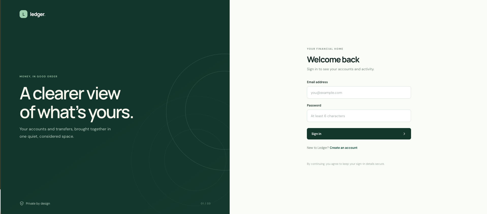
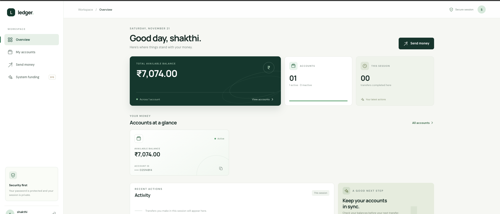
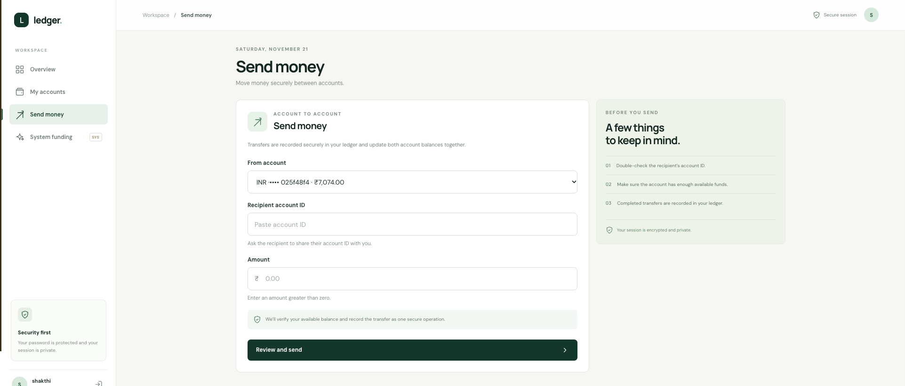
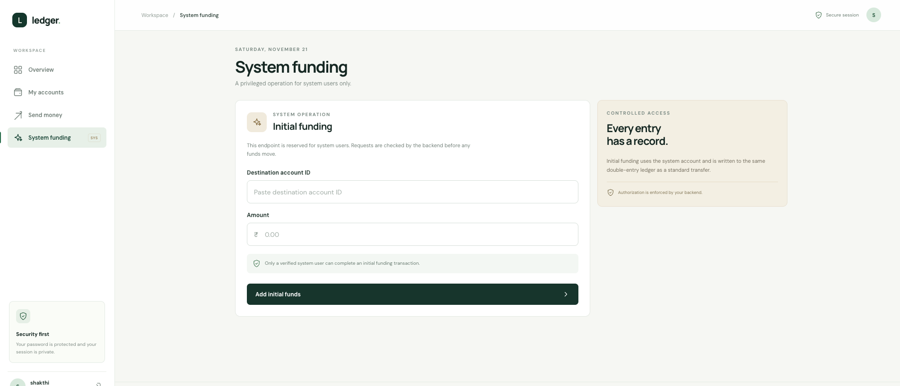

# Ledger — Banking & Transaction Management System

A full-stack banking ledger application built to explore backend engineering concepts such as authentication, account management, financial transactions, idempotency, and double-entry bookkeeping.

The project includes a Next.js dashboard and a Node.js/Express REST API backed by MongoDB.

<p align="center">
  <a href="https://backend-ledger-two-bay.vercel.app">
    <strong>🚀 Live Demo</strong>
  </a>
  &nbsp; | &nbsp;
  <a href="https://backend-ledger-ozhv.onrender.com">
    <strong>⚙️ Backend API</strong>
  </a>
</p>

## Application Preview

<!-- Replace these paths with screenshots of your actual application -->

### Signup



### Dashboard


### Account Management - Sending Money


### Fund Transfers - System funding


## Features

- **Authentication:** User registration, sign-in, and sign-out.
- **Account Management:** Create bank accounts, list accounts, and view account balances.
- **Fund Transfers:** Transfer funds between accounts.
- **Idempotency:** Use a fresh idempotency key for each transfer request to protect against duplicate processing.
- **Double-Entry Ledger:** Record balanced debit and credit entries for financial operations.
- **System Treasury:** Operator-controlled treasury provisioning and reserve top-ups.
- **Protected APIs:** Authentication and role-based authorization for restricted operations.

## Tech Stack

| Layer | Technology |
|---|---|
| Frontend | Next.js, React, JavaScript |
| Backend | Node.js, Express.js |
| Database | MongoDB, Mongoose |
| Authentication | JWT, HTTP-only cookies |
| API | REST |
| Deployment | Vercel (frontend), Render (backend) |

## Architecture

```text
                 User
                  |
                  v
          Next.js Frontend
                  |
             /api/*
                  |
                  v
           Express Backend
                  |
          Authentication
                  |
          Business Logic
                  |
                  v
              MongoDB
                  |
           Ledger Entries
```

The frontend lives inside `frontend/`, keeping the backend application and its dependencies separate.

During local development, Next.js proxies `/api/*` requests to the Express backend. This allows the browser to use same-origin requests and the backend's HTTP-only authentication cookie.

## Getting Started

### Prerequisites

- Node.js
- npm
- MongoDB connection string

### 1. Clone the repository

```bash
git clone YOUR_GITHUB_REPOSITORY_URL
cd backend-ledger
```

### 2. Configure the backend

Create a `.env` file in the project root using your own environment configuration.

Refer to `.env.example` for the required variable names.

### 3. Install backend dependencies

```bash
npm install
```

### 4. Start the backend

```bash
npm run dev
```

The backend runs on:

`http://localhost:3000`

### 5. Configure the frontend

Open another terminal:

```bash
cd frontend
npm install
```

Refer to the frontend `.env.example` file and configure `BACKEND_URL` if required.

### 6. Start the frontend

```bash
npm run dev
```

Open:

`http://localhost:3001`

## Backend Functionality

### Authentication

- Register a new user.
- Sign in with existing credentials.
- Sign out and invalidate the authentication token.

### Account Management

- Create a new account.
- Retrieve user accounts.
- Load individual account balances.

### Fund Transfers

- Transfer funds between accounts.
- Use an idempotency key for each transfer.
- Record corresponding financial ledger entries.

### System Treasury

The backend includes separate operator-only scripts for treasury provisioning and reserve top-ups.

Provision the system treasury:

```bash
SYSTEM_USER_ID=<your-system-user-id> \
SYSTEM_TREASURY_OPENING_BALANCE=1000 \
npm run provision:system-treasury
```

Add reserve funds:

```bash
SYSTEM_USER_ID=<your-system-user-id> \
TREASURY_TOPUP_AMOUNT=1000 \
TREASURY_TOPUP_REFERENCE=<unique-reference> \
npm run treasury:topup
```

Use a new reference for every distinct top-up. Reusing the same reference and amount is idempotent.

These operations require an authorized system user. Ordinary users cannot perform system treasury operations.

**Security note:** Never publish real user IDs, credentials, JWT secrets, database connection strings, or other private environment values in this README.

## Current Limitations

- A dedicated transaction-history API is not currently exposed.
- The dashboard displays actions from the current browser session rather than a complete persisted transaction history.

## Project Structure

```text
backend-ledger/
│
├── frontend/
│   ├── app/
│   ├── components/
│   └── ...
│
├── src/
│   ├── config/
│   ├── controllers/
│   ├── middleware/
│   ├── models/
│   ├── routes/
│   └── services/
│
├── scripts/
├── server.js
├── package.json
└── README.md
```

## Future Improvements

- Dedicated transaction-history API.
- Automated unit and integration tests.
- Improved transaction monitoring.
- PostgreSQL-based relational ledger architecture.
- Redis caching and asynchronous processing.
- Docker and cloud infrastructure.

## Disclaimer

This project is developed for educational and portfolio purposes. It is not intended to handle real customer funds or operate as a production banking service.